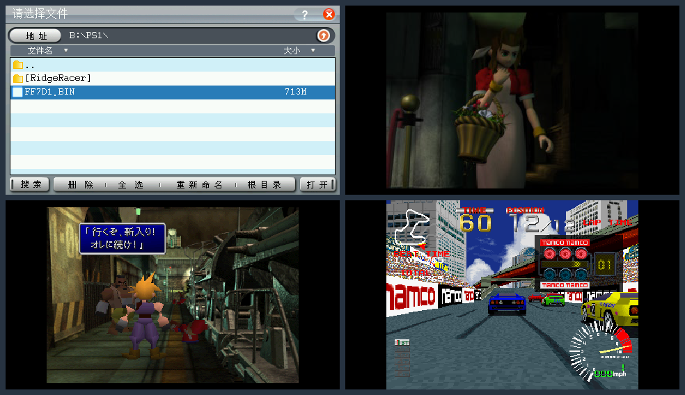

# BBK H1 PSX（PS1 模拟器）

在步步高 **H1 / Y100（V1.41）** 上重温 PS1，支持带声音运行《最终幻想 VII》《山脊赛车》。触屏即可暂停、自定义按键和调节音量，设置按游戏保存。针对 H1 优化，支持运行时 **408 MHz** 与 **FPS / CPU 频率显示**。

## 截图



H1 真机截图拼图，来自开发构建；从左到右、从上到下：文件选择、FF7 艾丽丝开场、FF7 火车站、山脊赛车。[截图来源](docs/evidence/screenshots.json)

## 快速开始

1. **下载** [即用安装包 v0.1.3（含 BIOS）](https://github.com/HelloClyde/BBKH1-PS1/releases/download/v0.1.3/BBKH1-PS1-v0.1.3-ready-install.zip)，解压后合并到 H1 内置磁盘根目录。程序和 BIOS 已放在对应目录，无需另行配置。
2. **放入游戏**：游戏可放在 SD 卡 `B:\PS1\`。多音轨游戏保留全部 BIN 文件，从 CUE 启动。
3. **开始玩**：从桌面打开 **PSX**，选择游戏。点击触屏打开暂停菜单，可改按键、调音量或退出。

即用包包含 SCPH1001 BIOS 和原创自检程序 `PS1/H1TEST.exe`，不包含商业游戏或 BBK 设备固件。已有 BIOS 时可跳过 `PS1/bios.bin`；单独下载 [PSX.bda](https://github.com/HelloClyde/BBKH1-PS1/releases/download/v0.1.3/PSX.bda) 可用于更新程序。

| 按键 | 操作 |
| --- | --- |
| 方向键 | PS1 方向键 |
| Z / X / C / V | × / □ / ○ / △ |
| A / S；Q / W | L1 / R1；L2 / R2 |
| Enter 或确认；空格 | Start；Select |
| 点击触屏；P / Esc / 返回 | 暂停菜单 |

旧版升级：移除 `A:\应用\程序\H1PS1.bda`，保留原有 `PS1` 目录和存档。

## 功能与设置

- **触屏菜单**：暂停、14 个 PS1 按钮映射、音量滑条、静音、音质、显示设置、关于和退出。支持方向键与确认键操作。
- **按游戏记住设置**：映射、音量和显示选项分别保存。退出程序还原设备原音量；“退出游戏”同步记忆卡。
- **画面信息**：黑边左上显示画面更新 FPS / 逻辑 FPS，例如 `30/60`；右上显示实际 CPU 频率，例如 `408M`。
- **镜像格式**：PS-X EXE、BIN、2048 字节扇区 ISO 和普通 BINARY CUE。缺少 BIOS 时尝试 HLE BIOS，兼容性有限。

记忆卡为 `A:\PS1\card1.mcd`、`card2.mcd`，每张 128 KiB；已有卡继续使用，安装包不覆盖。设置保存在 `A:\PS1\cfg-xxxxxxxx.0/.1`，校验损坏时优先回退上一份；日志为 `A:\PS1\h1ps1.log`。

## 优化与性能

针对 JZ4740 的主要优化：

- **MIPS 动态重编译**：4 MiB 代码缓存、O3/LTO、快速 RAM 访存与事件边界内的等待循环批处理。
- **MXU1 视频转换**：加速 MDEC 颜色转换，复用多行上下文，减少保存与恢复开销。
- **VLC HLE**：识别 SDK 解码循环，在事件预算内执行；不匹配或预算不足时回退原核心。
- **GPU 与画面输出**：成批像素处理、融合颜色转换与缩放；默认 GPU 跳帧 1，LCD 输出间隔可调。
- **极速音频**：32 kHz 单声道输出，减少高频与极弱尾音的混合开销，可切换插值和混响。
- **运行时 408 MHz**：正常退出还原原频，配置不匹配时保留原频；不修改启动固件或电压。

此前非 HUD 的 408 MHz 诊断构建，在 FF7 开声片头测试中的结果：

| 区间 | 逻辑帧/秒 | 音频欠载 |
| --- | ---: | ---: |
| 慢片头 6500–8800 | 约 60.01 | 0 |
| 后段 9500–11900 | 60.00 | 0 |
| 完整 12,000 帧 | 约 59.97 | 2 |

这是此前单轮片头的真机结果，不代表 v0.1.3、全游戏或赛车全部满速。完整记录与取舍见 [PERFORMANCE.md](PERFORMANCE.md)。

<details>
<summary>帧率口径、音频取舍与快捷键</summary>

游戏画面为 362×272，两侧各留 59 像素黑边。HUD 左侧第一个数字统计实际游戏图像拷贝次数，不是 LCD 面板电气刷新率；第二个数字是模拟逻辑推进速度，NTSC 满速通常约 60，PAL 约 50。暂停恢复后短暂显示 `--/--`。

极速档采用单声道 / 22.05 kHz 声部混合与极弱尾音省算，设备最终输出 32 kHz 单声道，默认关闭插值、混响。ADPCM 历史、包络、IRQ 和游戏时序继续推进；更高音质会增加开销。

| 快捷键 | 操作 |
| --- | --- |
| G | 切换 GPU 跳帧 / 完整渲染 |
| F | 切换 LCD 每帧、每两帧、每三帧输出 |
| T | 切换有损极速音频 / 原快速音频 |
| H | 切换快速音频 / 高斯插值与混响 |

P、Esc、返回及 F/G/H/T 保留为前端操作键。菜单内方向键与确认选择，返回/P 回上一级；根菜单继续游戏。

</details>

## 兼容性与验证

适用 H1 / Y100 V1.41。当前为预发布版；超频稳定性取决于设备，420 MHz 已因此前两轮自动重启而禁用。

v0.1.3 确切 BDA 已进行编译后 MIPS / H1 服务与寄存器模型验证，尚未真机复测。上方真机图来自已验证的开发构建，尚无 HUD；文件选择器和艾丽丝画面于 2026-10-19 补拍，来源与散列记录在 [screenshots.json](docs/evidence/screenshots.json)。

目前没有即时存档、换碟界面、模拟摇杆、第二手柄、PBP/压缩镜像或 SBI 支持；CUE 外部 PREGAP 和非 2352 字节原始轨道会拒绝。长期音画同步、完整游戏存取档与多碟流程仍待验证。

<details>
<summary>菜单与开发验证截图</summary>

以下菜单画面由 v0.1.3 确切 BDA 在主机 MIPS 服务模型中生成：


PSX 图标的四种 H1 原生资源解包预览：


原创 PS1 自检程序和 HUD 布局验证，均为主机服务模型，不是完整固件模拟器或真机截图：


</details>

## 开发与构建

构建需要 Windows、Git、Python 3.11 或 CI 使用的 Python 3.12，以及 GNU `mipsel-none-elf` GCC 15.2.0。Python 依赖固定在 [requirements.txt](requirements.txt)：Pillow 用于图标转换，Unicorn 与 pyelftools 用于主机验证。图标 PNG 和 Noto 菜单位图字形已收录，普通构建不读取系统字体；来源见 [assets/README.md](assets/README.md)。

| 依赖 | 固定提交 | 许可 |
| --- | --- | --- |
| [H1 SDK](https://github.com/MrDefinition1999/bbk-h1-bda-sdk) (`sdk/`) | `067fe072477861dfc8949d7b1a55279fb92d2548` | Apache-2.0 |
| [PCSX4ALL](https://github.com/dmitrysmagin/pcsx4all) | `c7faf12b893eba94faced88baa5e7dd059be58b7` | 各组件 GPL/MIT 等，见文件声明 |
| [zlib v1.3.1](https://github.com/madler/zlib) | `51b7f2abdade71cd9bb0e7a373ef2610ec6f9daf` | Zlib |

```powershell
git clone --recurse-submodules https://github.com/HelloClyde/BBKH1-PS1.git
cd BBKH1-PS1
python -m pip install -r requirements.txt
python tools/install_toolchain.py
python tools/build_release.py
```

工具链安装器校验固定下载 SHA-256；已有同版本工具链可设置 `$env:H1_GNU_BIN='工具链绝对路径/bin'`。输出：

```text
build/jit-o3-lto-gpulib-gskip1-idle-spans-mxu-vhle-vlc-spufast-lsu-present-mrows-vbatch-aturbo-cpu408/PSX.bda
```

同目录含 ELF、map、构建选项、源码散列和符号元数据。三个依赖均为固定 Git 子模块，补丁只应用到 `build/` 副本。完整源码 Release ZIP 包含对应依赖与 `SOURCE-MANIFEST.json`，无 Git 元数据时也可校验并构建。

构建日期固定为 2026-10-17 UTC，统一 BDA 头与上游日志的日期。需要原频构建时，将 `tools/release_config.py` 的全部参数传给 `tools/build.py`，把 `--cpu-mhz 408` 改为 `--cpu-mhz 336`。其他诊断选项见 `tools/build.py --help`。

```powershell
# 运行确切 BDA 的服务模型回归，不连接设备
python tools/verify_release.py
```

main/PR/手动运行触发 Actions 构建和模型验证，版本标签触发预发布。CI 不携带固件、BIOS 或商业游戏。

即用包在已发布安装包上添加获许可的 BIOS，程序字节保持一致。下载原始安装 ZIP 和对应 `SHA256SUMS.txt`，使用本地获许可 BIOS 打包：

```powershell
python tools/package_ready_install.py --base-install BBKH1-PS1-v0.1.3-install.zip --checksums SHA256SUMS.txt --bios SCPH1001.BIN
```

输出位于 `dist/ready/`，含即用安装 ZIP、文件清单和独立校验文件；BIOS 散列和发布者确认记录见 [bios-redistribution.json](docs/evidence/bios-redistribution.json)。

## 许可与感谢

本项目以 GNU GPL v2 提供，新增独立代码的 GPL-2.0-or-later 声明及上游原有许可继续保留，见 [LICENSE](LICENSE)、[NOTICE.md](NOTICE.md)。完整对应源码随 Release 提供。SDK、zlib、MIPS 动态重编译器等适用各自许可，不能以项目许可证替代。

感谢 PCSX4ALL、PCSX/PCSX-ReARMed 及各 GPU/SPU/GTE、动态重编译器作者，感谢 Dmitry Smagin、Ulrich Hecht、Daniel Silsby 等上游贡献者、zlib 作者和 MrDefinition1999 的 H1 SDK。感谢 HelloClyde 既有 BBK9588-gba/H1 运行时工作，以及用户提供设备、已有本地游戏和连续的真机声音与稳定性反馈。本项目不主张拥有相关游戏、固件或商标。
