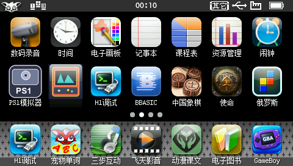
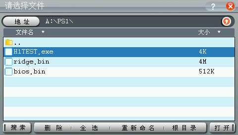
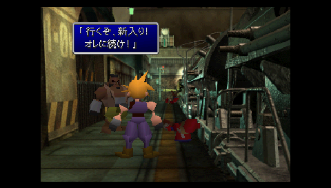
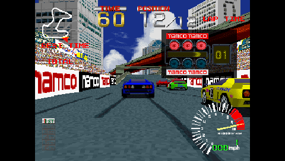
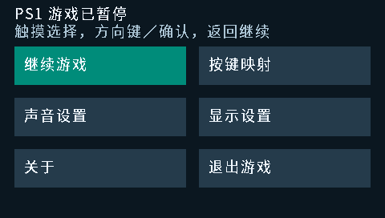
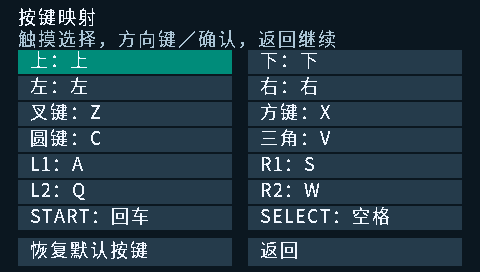
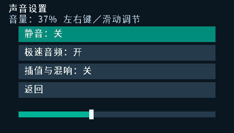
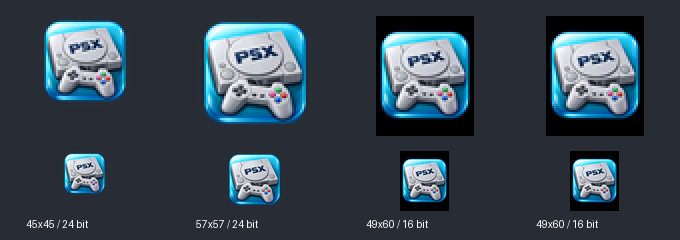
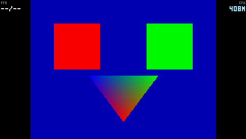
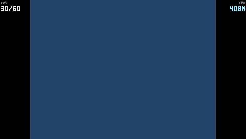

# BBK H1 PSX（PS1 模拟器）

面向步步高 **H1 / Y100、V1.41 固件**的原生 PS1 模拟器，基于固定版本 PCSX4ALL。支持 MIPS 动态重编译、JZ4740 MXU1 视频颜色转换、事件边界内的 VLC HLE 和带声音运行。

v0.1.3 将 BDA 文件名和桌面名称统一为 **PSX**，并换用符合 H1 风格的立体高光主机图标。保留与 H1 GBA 模拟器相同操作方式的触屏暂停菜单，支持 14 个 PS1 按钮映射、拖动音量、静音、音质、显示设置、关于和退出。设置按游戏分别记住。

本版保留黑边 HUD：左上显示 **画面更新 FPS / 逻辑 FPS**，例如 `30/60`；右上显示寄存器读出的 CPU 频率，例如 `408M`。这是预发布版，默认尝试运行时 408 MHz，正常退出时还原原频；配置不匹配时保留原频。它不修改启动固件或电压。420 MHz 已因此前两轮自动重启而禁用。

此前非 HUD 的 408 MHz 诊断构建，在 FF7 开声的 12,000 逻辑帧测试中，慢段约 **60.01**、后段 **60.00** 逻辑帧/秒，两段音频欠载均为 0，整轮欠载 2 次并正常退出。本版确切 BDA 仅做编译后 MIPS/服务模型验证，按用户要求没有再用 H1Debug 安装或测试。单轮片头结果不代表全游戏、全部设备或赛车都满速。详见 [验证与性能](PERFORMANCE.md)。

## 快速开始

从 [Releases](https://github.com/HelloClyde/BBKH1-PS1/releases) 下载 `PSX.bda`，或下载 `BBKH1-PS1-v0.1.3-install.zip`。将安装包内的目录合并到 H1 内置磁盘根目录：

```text
应用/程序/PSX.bda
PS1/H1TEST.exe          原创 PS1 自检程序，可直接试运行
```

升级时移除旧的 `A:\应用\程序\H1PS1.bda`，再复制 `PSX.bda`。游戏、BIOS、记忆卡和设置继续使用原有 `PS1` 目录。

从设备桌面打开“PSX”，在选择器中打开游戏。支持 PS-X EXE、BIN、2048 字节扇区 ISO 和普通 BINARY CUE。多音轨游戏必须保留 CUE 引用的全部 BIN 文件，并选择 CUE。大镜像可放在 SD 卡的 `B:\PS1\`；内置盘是 `A:`，电脑分配的盘符不固定。

如持有自己的 512 KiB PS1 BIOS，请复制为 `A:\PS1\bios.bin`；缺少时尝试 HLE BIOS，兼容性有限。BIOS、商业游戏及设备固件均不提供。共享记忆卡为 `A:\PS1\card1.mcd`、`card2.mcd`，每张 128 KiB；已有卡继续使用，安装包不覆盖存档。退出时等待保存结束。日志为 `A:\PS1\h1ps1.log`。

| 按键 | 操作 |
| --- | --- |
| 方向键 | PS1 方向键，支持同时按键 |
| Z / X / C / V | × / □ / ○ / △ |
| A / S；Q / W | L1 / R1；L2 / R2 |
| Enter 或确认；空格 | Start；Select |
| 点击触屏；P / Esc / 返回 | 打开暂停菜单 |
| 菜单内方向键、确认/回车/Z | 选择菜单项 |
| 菜单内返回/P | 返回上一级；根菜单继续游戏 |
| G | 切换 GPU 跳帧/完整渲染 |
| F | 切换 LCD 每帧、每两帧、每三帧输出 |
| T | 切换有损极速音频/原快速音频 |
| H | 切换快速音频/高斯插值与混响 |

暂停菜单可用触摸点选；按键映射页先选 PS1 按钮，再按实体键。方向键、四个面键、L1/R1/L2/R2、START/SELECT 均可设置，也可恢复默认。P、Esc、返回及 F/G/H/T 快捷键保留。音量可拖动滑条或用左右键调整，退出程序后还原设备原音量。菜单的“退出游戏”会同步记忆卡并退出。

设置存储在内置盘 `A:\PS1\cfg-xxxxxxxx.0/.1` 的交替校验记录中，与游戏镜像及记忆卡分开。最新记录损坏时回退上一份；两份都损坏时保留原文件、本次临时使用默认设置。保存失败会提示，不覆盖已有记忆卡。

HUD 不占用中间 362×272 游戏画面，仅使用两侧各 59 像素黑边。采样约每秒更新，刚开始和暂停恢复后显示 `--/--`。左侧第一个数字统计实际游戏图像拷贝次数，并非 LCD 面板电气刷新率，也不保证游戏原生动画每秒有同样多的不同画面；第二个数字是模拟逻辑推进速度。NTSC 满速通常约 60，PAL 约 50。

默认 GPU 跳过一帧渲染；快速音频输出为 **32 kHz 单声道**，极速档减少高频和极弱尾音，关闭插值、混响。ADPCM 历史、包络、IRQ 和游戏时序继续按原时钟推进。用户此前反馈该档更连续且音质可接受；需要更好音质可按 T/H，性能会随之变化。

目前没有即时存档、换碟界面、模拟摇杆、第二手柄、PBP/压缩镜像或 SBI 支持。CUE 的外部 PREGAP 及非 2352 字节原始轨道会拒绝。长时间音画同步、完整游戏内存取档、多碟流程及更多游戏仍待验证。超频兼容性取决于设备，正常退出路径已纳入模型检查，本版尚未真机复测。

## 截图

以下是此前开发测试保存的 **H1 / Y100 V1.41 真机原始截图，480×272**。桌面仍显示旧名“PS1模拟器”和旧图标，游戏画面尚未加入 HUD；v0.1.3 已更名为 PSX 并更新图标。截图用于展示运行效果，不代表当前版本的新性能测试。[截图来源、对应构建与 SHA-256](docs/evidence/screenshots.json)。

**H1 桌面**



**文件选择器**



**《最终幻想 VII》开场动画**


**《最终幻想 VII》火车站**



**《山脊赛车》**



<details>
<summary>暂停菜单、图标资源与开发验证截图</summary>

以下菜单画面由 v0.1.3 确切 BDA 在主机 MIPS 服务模型中运行生成，尚未经过真机验证：







PSX 图标的四种 H1 原生资源解包预览：



本版确切 BDA 在 Unicorn MIPS32 + H1 服务模型中运行原创 PS1 自检程序的画面；这是主机服务模型，不是完整固件模拟器或真机截图：



HUD 布局验证中间使用纯色测试背景：



</details>

## 依赖与构建

使用成品只需 H1/Y100 V1.41、自己的游戏及适用的 BIOS；不需要在设备安装 SDK、Python 或 H1Debug。

本地开发构建使用 Windows、Python 3.11；CI 配置 Python 3.12。构建另需 Git、GNU `mipsel-none-elf` GCC 15.2.0。Python 依赖固定在 [requirements.txt](requirements.txt)。Pillow 用于 PNG/图标处理，Unicorn 与 pyelftools 只用于主机验证。图标 PNG 与 Noto Sans CJK SC 菜单位图字形（OFL 1.1）已收录，默认构建不读取系统字体；再生方式见 assets/README.md。原创 PS1 自检程序直接由 GNU 汇编器生成，不依赖 Sony SDK。

| 依赖 | 固定提交 | 许可 |
| --- | --- | --- |
| [H1 SDK](https://github.com/MrDefinition1999/bbk-h1-bda-sdk) (`sdk/`) | `067fe072477861dfc8949d7b1a55279fb92d2548` | Apache-2.0 |
| [PCSX4ALL](https://github.com/dmitrysmagin/pcsx4all) | `c7faf12b893eba94faced88baa5e7dd059be58b7` | 各组件 GPL/MIT 等，见文件声明 |
| [zlib v1.3.1](https://github.com/madler/zlib) | `51b7f2abdade71cd9bb0e7a373ef2610ec6f9daf` | Zlib |

H1 项目使用 H1 专用 SDK，不使用 9588 固件 ABI。三个依赖均为固定 Git 子模块；构建拒绝提交不符或依赖源码改动，补丁只应用到 `build/` 副本。

```powershell
git clone --recurse-submodules https://github.com/HelloClyde/BBKH1-PS1.git
cd BBKH1-PS1
python -m pip install -r requirements.txt
python tools/install_toolchain.py
python tools/build_release.py
```

工具链安装器校验固定下载 SHA-256；已有同版本工具链可设置 `$env:H1_GNU_BIN='工具链绝对路径/bin'`。输出位于：

```text
build/jit-o3-lto-gpulib-gskip1-idle-spans-mxu-vhle-vlc-spufast-lsu-present-mrows-vbatch-aturbo-cpu408/PSX.bda
```

同目录含 ELF、map、构建选项、源码散列和符号元数据。构建器固定 `SOURCE_DATE_EPOCH` 为 2026-10-17 00:00:00 UTC，统一 BDA 头和上游日志的编译日期，避免本机与 CI 时区或编译日期导致 BDA 不同。完整源码 Release ZIP 包含三个依赖的对应源码和 `SOURCE-MANIFEST.json`；解压后可直接运行上述 pip、工具链及构建命令，构建器用清单校验无 Git 元数据的源码快照。

需要原频构建时，将 `tools/release_config.py` 中的全部构建参数原样传给 `tools/build.py`，只把 `--cpu-mhz 408` 改为 `--cpu-mhz 336`，其输出目录不带 `-cpu408`。`tools/build.py --help` 列出诊断和实验选项；TLB 快速映射、扩大视频包装层 HLE、3D HLE 及 ADPCM 缓存实验默认关闭，不能据局部指令减少推断游戏提速。

```powershell
# 对本版确切 BDA 执行服务模型回归，不会连接 USB 或设备
python tools/verify_release.py
```

main/PR/手动运行触发 Actions 构建和模型验证；`v` + VERSION 标签触发预发布。CI 不携带设备固件、BIOS 或商业游戏，不声称真机测试通过。

## 许可与感谢

本项目以 GNU GPL v2 提供，新增独立代码的 GPL-2.0-or-later 声明及上游原有许可继续保留，见 [LICENSE](LICENSE)、[NOTICE.md](NOTICE.md)。完整对应源码随 Release 提供。SDK、zlib、MIPS 动态重编译器等适用各自许可，不能以项目许可证替代。

感谢 PCSX4ALL、PCSX/PCSX-ReARMed 及各 GPU/SPU/GTE、动态重编译器作者，感谢 Dmitry Smagin、Ulrich Hecht、Daniel Silsby 等上游贡献者、zlib 作者和 MrDefinition1999 的 H1 SDK。感谢 HelloClyde 既有 BBK9588-gba/H1 运行时工作，以及用户提供设备、已有本地游戏和连续的真机声音与稳定性反馈。本项目不主张拥有相关游戏、固件或商标。
